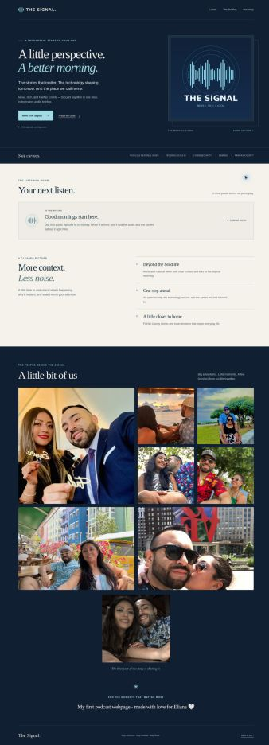
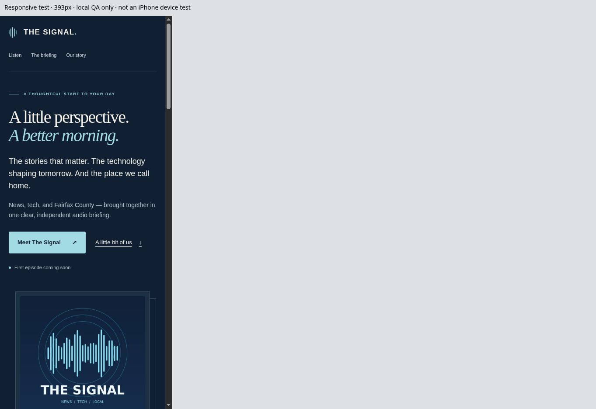

# The Signal editorial redesign

Owner: Sayuri's Astra · 2026-10-31 · feature/sayuri-editorial-redesign

Production baseline and rollback target: `16245bf7096eaebad464e01800e3f27c52749a45`.
The owner authorized deployment in the active engineering conversation on 2026-10-31 ("Ok deploy", followed by "Keep going"). The website change goes through a feature branch, pull request, checks and the existing Pages deployment. Backend audio publication remains a separate release decision. Coordination was recorded in private engineering issue #1 before the dependency-install workflow change; no independent backend review is claimed.

## What changes for a listener

The former 800px-wide page placed the family gallery before future episode players, presented artwork at only 180px, and had no section navigation. The redesign gives the show a clear introduction, a dedicated listening area before the gallery, links to the reporting behind each episode, and a more deliberate personal ending.

Three directions were considered: a light newspaper layout, an entirely dark audio-studio layout, and a navy/ivory editorial design. The third keeps the original navy/cyan identity, gives reporting a lighter reading surface, and leaves the photography and dedication warm and prominent.

The design uses Georgia display typography with system sans-serif body text; navy `#101f31`, ivory `#f5f2eb`, cyan `#a3dbe5`; a 1180px maximum content width; 20px mobile side margins; 44px navigation targets and 50px main actions. There are no external fonts, tracking scripts, third-party runtime assets, or added JavaScript. The original generated 1600px show cover is retained.

## Preserved behavior

- All eight original JPEGs remain byte-for-byte unchanged; the eighth is centered on a separate row. All eight contain zero EXIF fields in the inspected archive.
- The dedication remains exactly: `My first podcast webpage - made with love for Eliana 🤍`.
- The existing public approval validator and RSS function are unchanged. Deployment URL, branch trigger, Pages permissions, and existing media URLs are unchanged.
- An empty site has no fake player, feed link, subscription form, or invented episode. Future real episodes get native labeled audio controls, download links and expandable source attribution.
- Up to eight episodes appear immediately; additional supported episodes remain accessible under Earlier episodes with stable date/edition anchors and existing media URLs.

## Files

`scripts/site_presentation.py` owns presentation. `assets/page.html` and `assets/site.css` contain the layout and design system. `scripts/build_site.py` delegates HTML rendering and copies CSS, retaining source validation, RSS, audio-copying and gallery extraction. `requirements.txt` pins the tested Pillow 13.0.0 version. The deploy workflow only changes its dependency-install command; a separate read-only PR workflow runs tests/build without deploying.

## Evidence

- 13 unittest checks pass with Pillow 13.0.0: empty and populated builds; all eight image bytes and exact dedication; centered final-photo rule; feed/source/enclosure preservation; cleanup of stale feed/media; HTML injection escaping; no autoplay; native audio labels; navigation targets; historical episode anchors; absence of authored executable JavaScript; keyboard/reduced-motion CSS.
- Browser render checks at 320, 375, 393, 768, 1024 and 1440px: no horizontal overflow. The Chromium scrollbar consumes 15px of each test frame; recorded content widths were 305, 360, 378, 753, 1009 and 1425px. These are responsive Chromium checks, not iPhone Safari or CarPlay tests.
- Desktop inspection: all eight images loaded; final-photo midpoint matched the gallery midpoint.
- A clearly labeled local-only, three-second synthetic silent MP3 reached the browser's ended state, with duration/currentTime both 3 seconds and readyState 4. No recording or synthetic episode is included in the production source.
- Seven principal foreground/background palette pairs measured 5.24:1–14.88:1 contrast. This is a palette check, not complete WCAG certification.
- HTML and CSS together are under 20KB uncompressed; cover is approximately 138KB. Existing gallery stays around 1.7MB and loads lazily. No performance score is fabricated.
- The dependency audit after the local toolchain and Pillow update reports zero known advisories across 50 installed packages. This is a point-in-time advisory check, not proof of safety.

## Render previews

The images below are real browser captures of this branch. The mobile capture is a 393px iframe rendering in Chromium. It is not a device screenshot.

## Remaining review

Test iPhone Safari, VoiceOver, 200% text zoom, preferred contrast settings, and native audio interaction on the owner's device. Review the unchanged intentionally public photographs and dedication as part of design approval. Browser screenshots or green CI do not authorize publishing any audio. Release integration remains with Fadi's Astra; the security assessment is held separately in the private repository.
